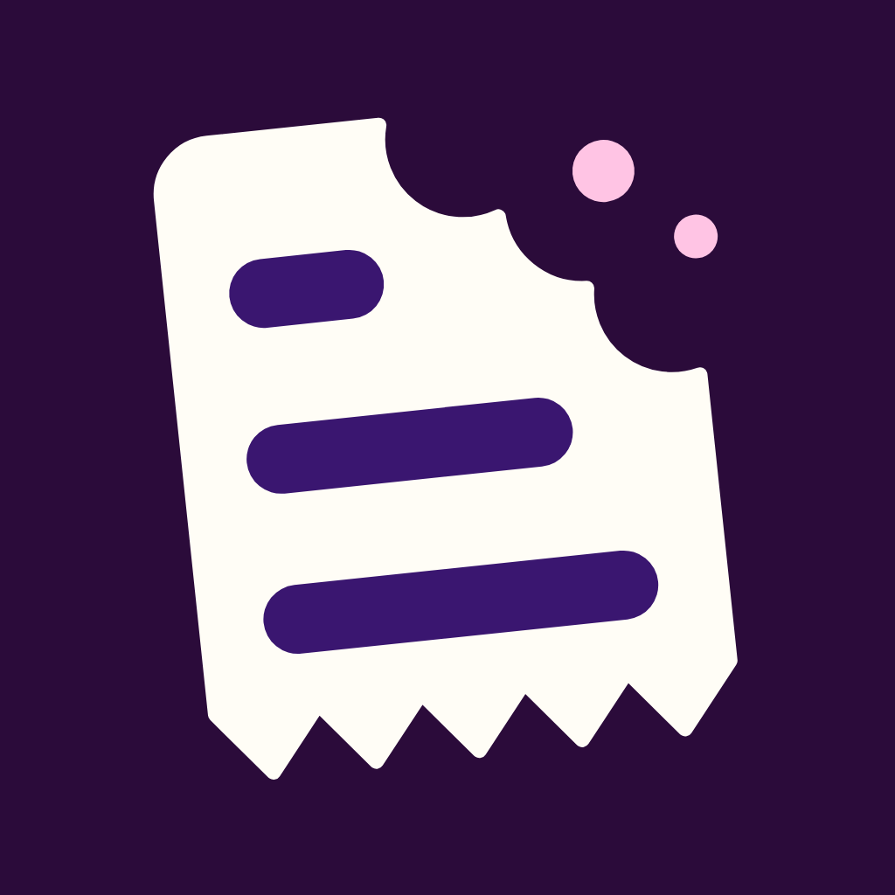
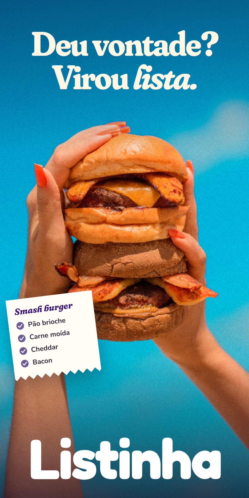
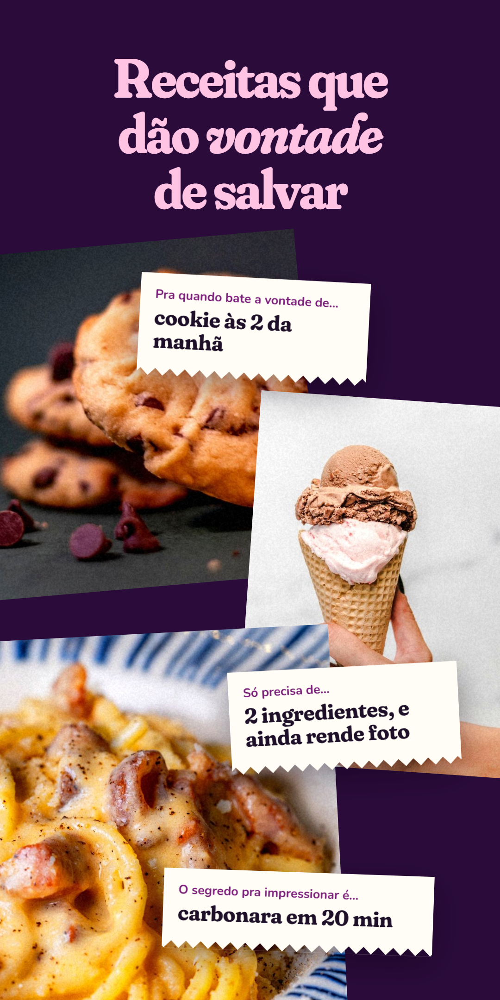
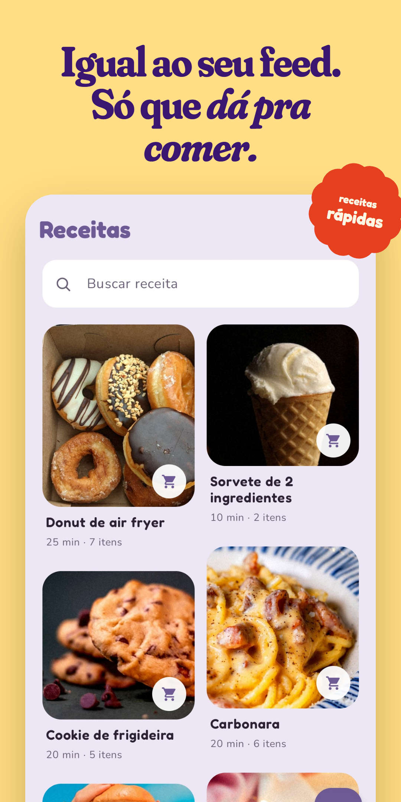
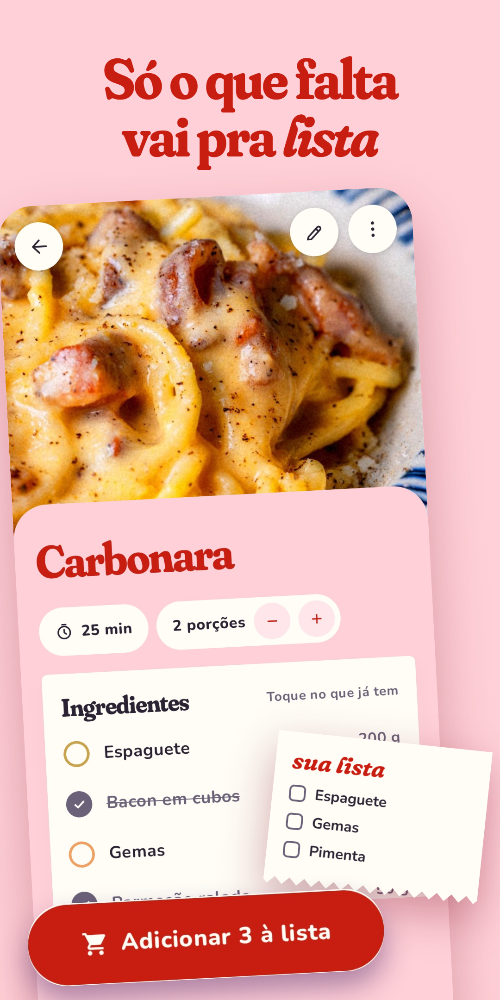
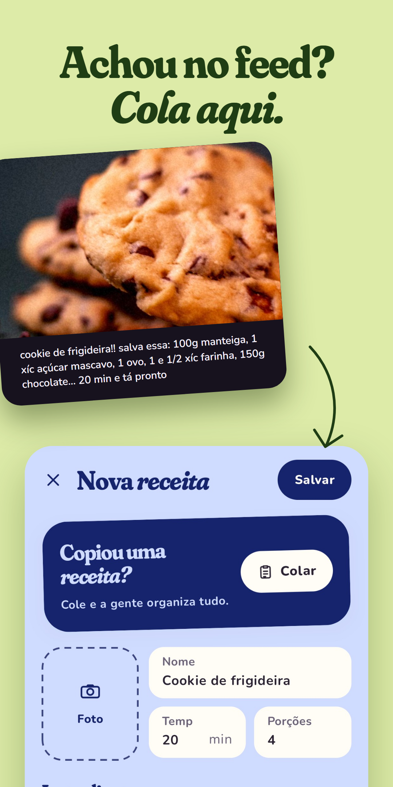
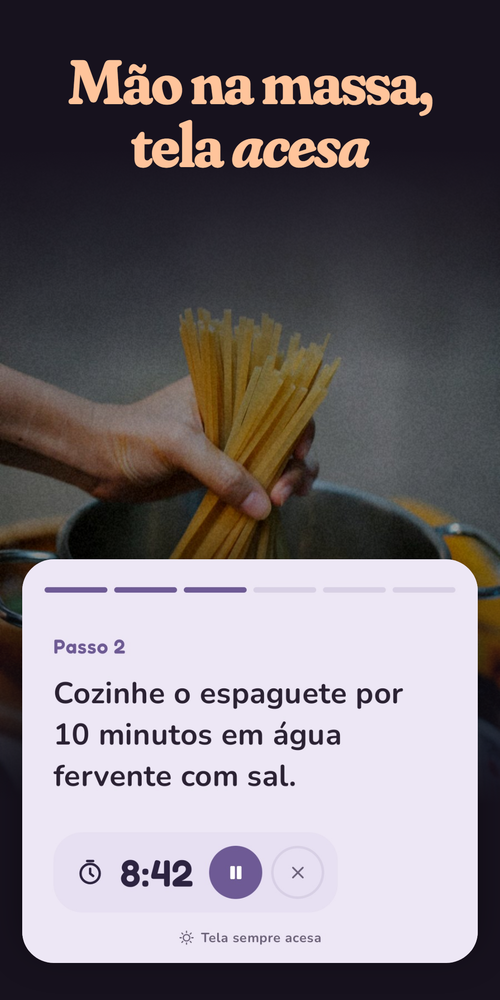
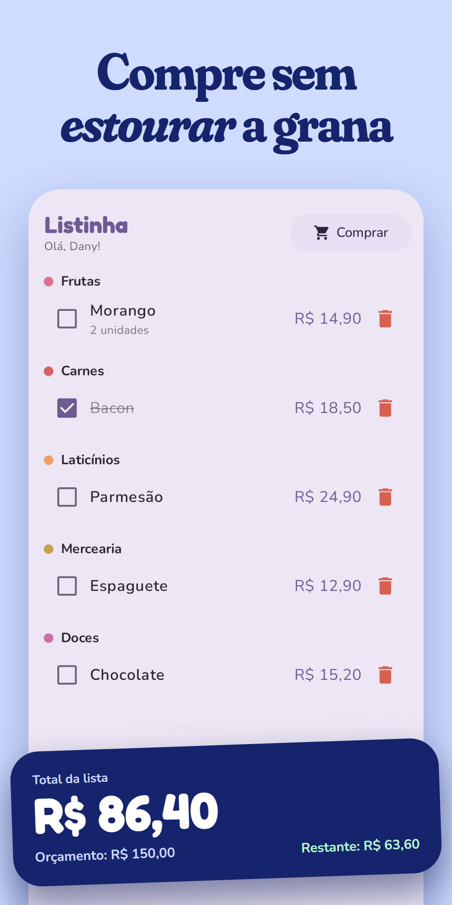

<div align="center">



# Listinha

**Suas receitas viram lista de compras num toque.**

App Android de lista de compras e receitas. Organiza os itens por categoria, acompanha quanto você está gastando e guarda um caderno de receitas que já monta a lista por você.

<br />


<sub>A versão 2.0 está em análise na Google Play. O link de download chega em breve.</sub>

<br />


</div>

<br />

## Sobre o projeto

O **Listinha** é um app Android publicado na **Google Play Store**, feito para quem faz feira e mercado. A ideia nasceu de um problema simples: anotar item por item toda semana é chato e fácil de esquecer algo.

O diferencial está em unir **receitas e lista de compras** no mesmo lugar. Você guarda suas receitas favoritas com foto, ingredientes e modo de preparo e, quando bate a vontade de cozinhar, um toque em **"Adicionar à lista"** joga todos os ingredientes na sua lista de compras, já organizados por categoria e prontos para o supermercado.

Salvar receita também é fácil: cole o texto de um blog ou compartilhe direto do Instagram, do navegador ou do WhatsApp. Quando os ingredientes e os passos vêm em linhas, o Listinha separa quantidades, categorias e passos sozinho; depois é só revisar. Na hora de cozinhar, o modo passo a passo tem timer e mantém a tela acesa.

Grátis, sem anúncios, com login pelo Google e sincronização na nuvem.

<br />

## Telas

<div align="center">

<table>
  <tr>
    <td align="center"></td>
    <td align="center"></td>
    <td align="center"></td>
    <td align="center"></td>
  </tr>
  <tr>
    <td align="center"></td>
    <td align="center"></td>
    <td align="center"></td>
  </tr>
</table>

</div>

<br />

## Identidade visual

**"Deu vontade? Virou *lista.*"** A lista de compras é uma notinha de papel picotada, com o total como cupom e o item riscado de caneta. Cada área tem um sabor chapado: manteiga na lista, pistache no mercado, morango nas receitas, mirtilo na receita nova, açaí no perfil e noite no modo cozinhar. Tudo em tema claro e escuro. O guia completo está em [`brand/README.md`](brand/README.md).

<br />

## Funcionalidades

Você guarda uma receita e, com um toque, os ingredientes vão para a lista de compras, cada um na sua categoria.

As receitas ficam numa grade com fotos grandes, no estilo do Pinterest. Se uma receita não tem foto, ela ganha uma capa com a inicial do nome.

Para salvar uma receita nova, é só colar o texto de um blog, do WhatsApp ou do Instagram, ou compartilhar direto de outro app. Quando os ingredientes e os passos vêm em linhas separadas, o Listinha separa o nome, as quantidades, as categorias e o modo de preparo, e você só confere antes de salvar.

Na hora de cozinhar, cada passo aparece sozinho na tela, com letra grande, timer em um toque e a tela sempre acesa.

Dá para mudar o número de porções que as quantidades se ajustam sozinhas. Também dá para marcar o que você já tem em casa, assim só o que falta vai para a lista.

Na lista, os itens ficam separados por categoria, como frutas, carnes, mercearia e limpeza. Você pode definir quanto quer gastar e acompanhar o total enquanto compra, e no modo compra é só ir marcando os itens pelos corredores do mercado.

O login é feito com a conta Google, então tudo fica salvo na nuvem. Tem tema claro e escuro, e nenhuma propaganda.

<br />

## Tecnologias

| Camada | Stack |
|--------|-------|
| **Linguagem** | Kotlin |
| **UI** | Jetpack Compose · Material 3 (Material You) |
| **Arquitetura** | MVVM · ViewModel · StateFlow |
| **Autenticação** | Firebase Auth · Credential Manager (login com Google) |
| **Banco de dados** | Cloud Firestore (nuvem, por usuário) |
| **Assíncrono** | Kotlin Coroutines |
| **Imagens** | Coil |
| **Testes** | JUnit · Firebase Emulator Suite (regras de segurança e fluxos reais) · uiautomator |
| **Outros** | Splash Screen API · R8 · ícone adaptativo e temático · fontes Fraunces + Fredoka + Nunito |

<br />

## Arquitetura

O app segue **MVVM** com uma separação clara entre dados, lógica de tela e interface. A UI é 100% declarativa em Jetpack Compose, e cada tela observa o estado exposto pelo seu `ViewModel`.

```
app/src/main/java/com/listinha/app/
├── auth/            # AuthViewModel: login com Google
├── data/            # Modelos e repositórios (Item, Recipe, Profile, Firestore)
├── list/            # ListViewModel: lista de compras e orçamento
├── recipes/         # RecipeViewModel: receitas
├── ui/
│   ├── components/   # Componentes e peças da marca (BrandKit: notinha, títulos, botões)
│   ├── screens/      # Telas (Login, Home, Lista, Receitas, Detalhe, Modo cozinhar, Perfil)
│   └── theme/        # Sabores por área, tipografia e tema (claro/escuro)
└── util/            # Moeda, imagem, leitura de receita colada (RecipeText) e contas de cozinha (Cooking)
```

### Segurança dos dados

Como o app fala direto com o Firestore, a proteção fica nas **regras de segurança**: cada pessoa só acessa a própria "gaveta" (`users/{uid}/...`) e nada além disso.

```js
// firestore.rules
function isOwner(userId) {
  return request.auth != null && request.auth.uid == userId;
}

match /users/{userId} {
  allow read, write: if isOwner(userId);
  match /{document=**} {
    allow read, write: if isOwner(userId);
  }
}
// Qualquer outro caminho fica NEGADO por padrão.
```

<br />

## Como rodar localmente

> O projeto usa Firebase, então precisa das suas próprias credenciais para compilar.

```bash
# 1. Clone o repositório
git clone https://github.com/Danyyks/Listinha-Android.git

# 2. Abra a pasta no Android Studio
```

3. Crie um projeto no [Firebase](https://console.firebase.google.com/), ative **Authentication (Google)** e **Cloud Firestore**.
4. Baixe o `google-services.json` e coloque em `app/`.
5. Publique as regras do arquivo `firestore.rules`.
6. Rode o app (`Shift + F10`).

### Testes

As regras que leem receita colada, escalam porções e detectam o timer têm testes que rodam no computador, sem emulador. No Android Studio: clique com o botão direito em `app/src/test` → **Run 'Tests in test'**. Pela linha de comando:

```bash
gradle testDebugUnitTest
```

Regras de segurança, fluxos contra o Firebase Emulator Suite (projeto falso, sem produção) e a vitrine de telas estão em [`docs/testes/README.md`](docs/testes/README.md).

> **Atenção:** o Android usa outro motor de expressões regulares (ICU) que o Java do computador. Uma regra pode passar no teste e quebrar no celular. Por isso, depois de mexer em `util/RecipeText.kt` ou `util/Cooking.kt`, abra também a aba Receitas no emulador.

<br />

## Roadmap

- [ ] **Premium com IA**: geração de receitas e sugestões de compra.
- [ ] Compartilhar listas entre pessoas da casa.
- [ ] Histórico de preços e comparação entre compras.

<br />

## Autor

Feito por **Dany Jonathan Bueno**, estudante de Análise e Desenvolvimento de Sistemas e desenvolvedor em formação.

[](https://linkedin.com/in/danyyjonathan)
[](https://instagram.com/danyyjonathan)
[](https://mail.google.com/mail/?view=cm&fs=1&to=danyy.jonathan@gmail.com)

<br />

<div align="center">
<sub>Listinha · app Android publicado na Google Play · Kotlin + Jetpack Compose + Firebase</sub>
</div>
